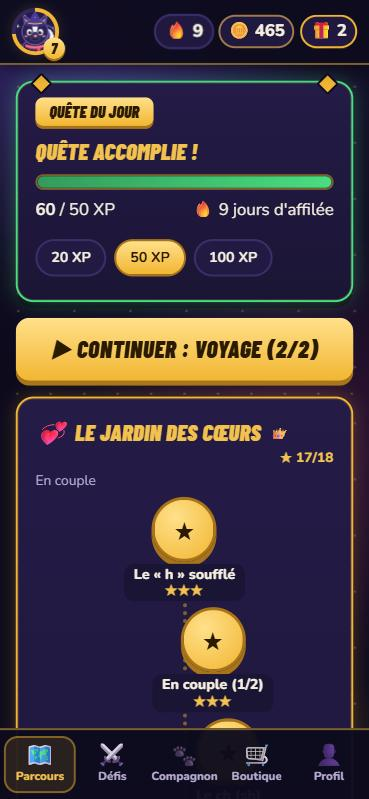
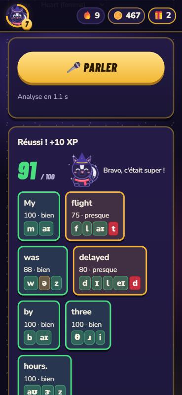
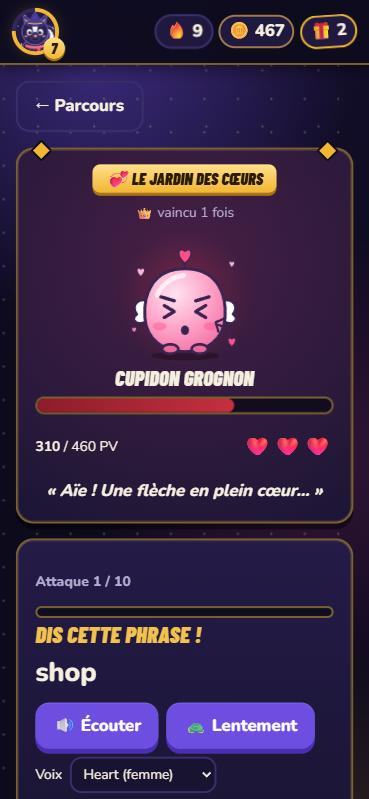
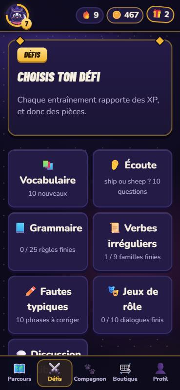
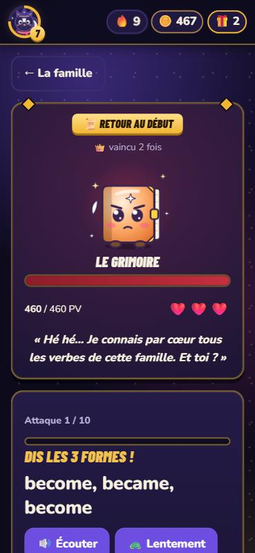
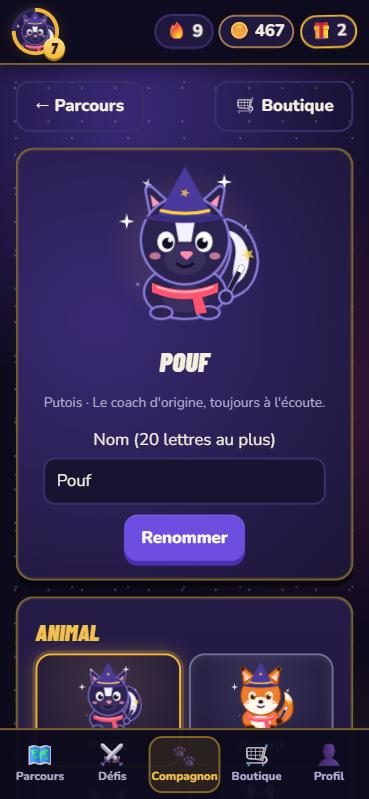

# Labo d'accent

Appli gratuite pour apprendre à **parler** anglais quand on est francophone, façon jeu vidéo.
Tu dis une phrase au micro : l'appli reconnaît **chaque son** que tu prononces, le compare à la prononciation
américaine attendue et colore chaque mot (vert : bien, orange : presque, rouge : à revoir), avec un conseil en français.

Tout se passe **dans ton navigateur** : pas de compte, pas d'abonnement, pas de serveur, et ta voix n'est jamais envoyée sur Internet.

**👉 Essayer l'appli : <https://gappix-sii.github.io/labo-accent/>** (Chrome sur PC ou Android)

<table>
  <tr>
    <td align="center"><br><sub>La carte du parcours</sub></td>
    <td align="center"><br><sub>La note, son par son</sub></td>
    <td align="center"><br><sub>Un boss à chaque région</sub></td>
  </tr>
  <tr>
    <td align="center"><br><sub>Les défis</sub></td>
    <td align="center"><br><sub>Le Grimoire des verbes</sub></td>
    <td align="center"><br><sub>Ton compagnon</sub></td>
  </tr>
</table>

## Ce que tu y trouves

- **Le parcours** : 50 leçons sur une carte de 9 régions (Le Jardin des Cœurs, Le Port des Voyageurs, Le Village de Bonjour…). Une leçon de son (le « h » soufflé, le « th »…), puis une leçon de phrases utiles qui le réutilise, et les bases : mots-questions, jours, mois, nombres, dates. De 1 à 3 étoiles par leçon.
- **Les boss** : un boss garde la fin de chaque région. Il faut 65 pour le toucher (coup critique dès 85). Sous 50, il se soigne ; sous 20, il te prend aussi un cœur.
- **Les défis** :
  - **vocabulaire** : 501 mots du A1 au C1, du français vers l'anglais au micro, avec révisions espacées ;
  - **écoute** : « ship » ou « sheep » ? 32 paires de mots que les Français confondent ;
  - **grammaire** : 25 règles, chacune avec exemples et phrase à dire ;
  - **verbes irréguliers** : 67 verbes en 9 familles qui se ressemblent (come · came · come…), chacune gardée par Le Grimoire ;
  - **fautes typiques** : 46 erreurs de Français à corriger à voix haute ;
  - **jeux de rôle** : 10 dialogues de la vie courante (café, hôtel, médecin…).
- **La discussion libre** (facultative) : une vraie conversation à l'oral avec l'IA Gemini de Google, qui corrige chaque phrase. Il faut Internet et ta propre clé gratuite Google ; elle reste sur ton appareil.
- **Le jeu** : XP, niveaux, série de jours, objectif du jour, pièces, coffres et boîtes à butin (probabilités affichées, jamais d'argent réel). Un compagnon à habiller : 9 animaux et 84 accessoires.
- **Le transfert** : un QR code fait passer ta progression du PC au téléphone, sans compte ni serveur.

## Comment ça marche

- **La note** vient d'un petit modèle d'intelligence artificielle qui reconnaît les sons de la parole ([speako-phoneme-recognizer](https://huggingface.co/robg/speako-phoneme-recognizer)). Il tourne dans ton navigateur. La première fois, environ 355 Mo sont téléchargés depuis Hugging Face (en Wi-Fi de préférence), puis gardés par le navigateur. Chaque fichier est vérifié par son empreinte avant usage.
- **La prononciation attendue** vient du dictionnaire CMU (anglais américain).
- **Les voix** des phrases à écouter (une voix de femme, une voix d'homme) ont été fabriquées à l'avance avec la voix de synthèse libre Kokoro, puis livrées avec l'appli : 2 736 petits fichiers audio.
- **Ta progression** reste dans ton navigateur. Rien n'est envoyé ailleurs, sauf ce que tu dis dans la discussion libre (à Google, avec ta clé).

## Où en est le projet

C'est la **version 1 en cours de finition** : tout ce qui est décrit plus haut fonctionne, sur PC et sur Android.
Il reste à la rendre installable sur l'écran d'accueil et utilisable en mode avion. La feuille de route est dans [PLAN.md](PLAN.md), les choix et leurs raisons dans [PROJET.md](PROJET.md).

## Limites honnêtes

- La note mesure si chaque son ressemble à la prononciation américaine de référence : un accent britannique correct peut être un peu pénalisé.
- L'accent tonique et l'intonation ne sont pas encore notés.
- Sur un téléphone ancien, le moteur peut être lent à se charger.
- Le micro demande une page sécurisée (`https`, ou `localhost` sur ton PC).

## Pour les curieux du code

HTML, CSS et JavaScript sans framework ni dépendance. Il faut [Node.js](https://nodejs.org/) 26 ou plus.

```bash
npm start   # lance l'appli sur http://localhost:8000
npm test    # lance les tests (lanceur intégré de Node)
```

| Dossier | Rôle |
|---|---|
| `js/core/` | Règles pures (progression, XP, révisions, jeu, boss, verbes, transfert), toutes testées |
| `js/content/` | Contenus : leçons, régions, vocabulaire, grammaire, verbes, dialogues, dessins |
| `js/engine/` | Moteur : micro, reconnaissance des sons, score, vérification des modèles, lecture des sons, Gemini |
| `js/screens/` | Un fichier par écran |
| `data/` | Dictionnaire CMU et sons des phrases |
| `vendor/` | Bibliothèques copiées dans le dépôt (aucun CDN) |
| `tools/` | Serveur local et fabrique des sons |
| `test/` | Tests |

Voir [SECURITY.md](SECURITY.md) pour la sécurité et [NOTICE.md](NOTICE.md) pour les licences.
